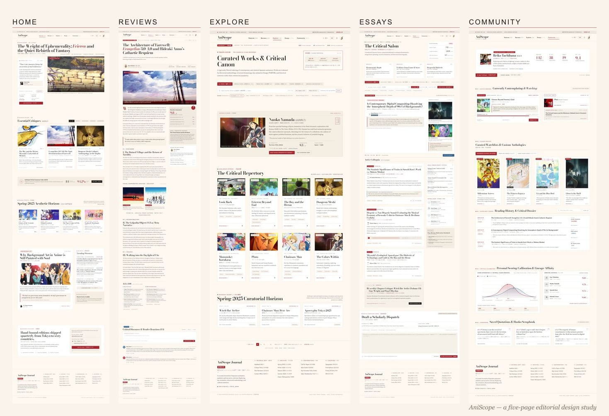
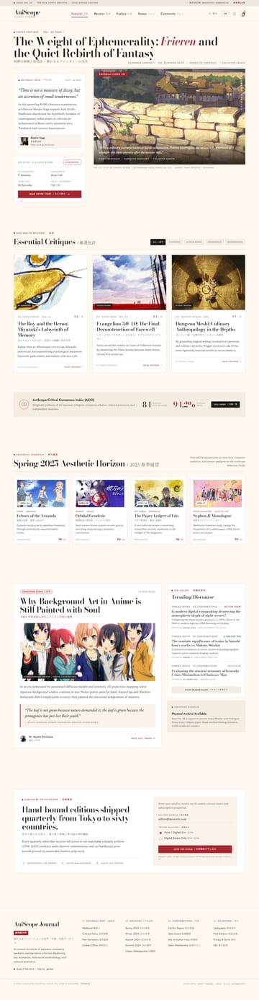
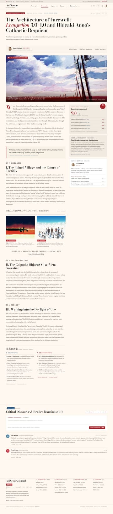
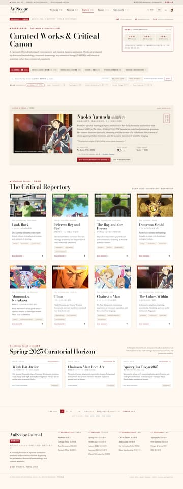
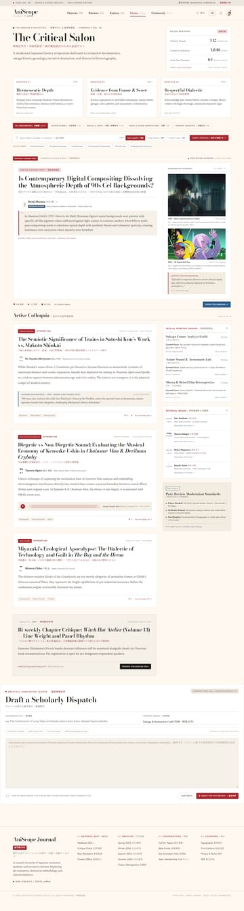
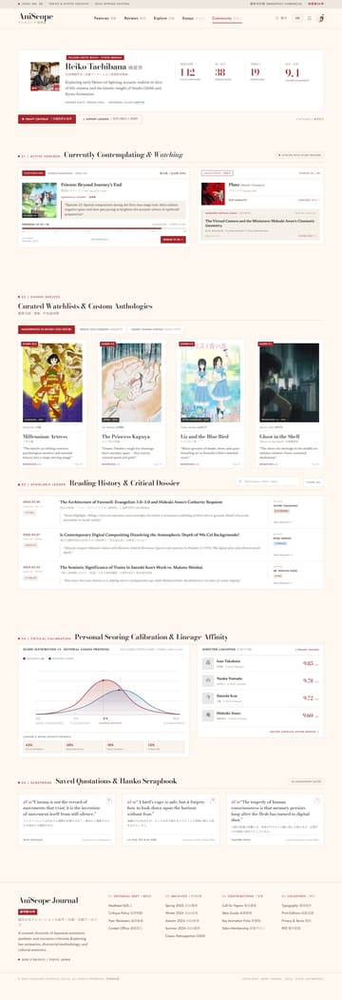
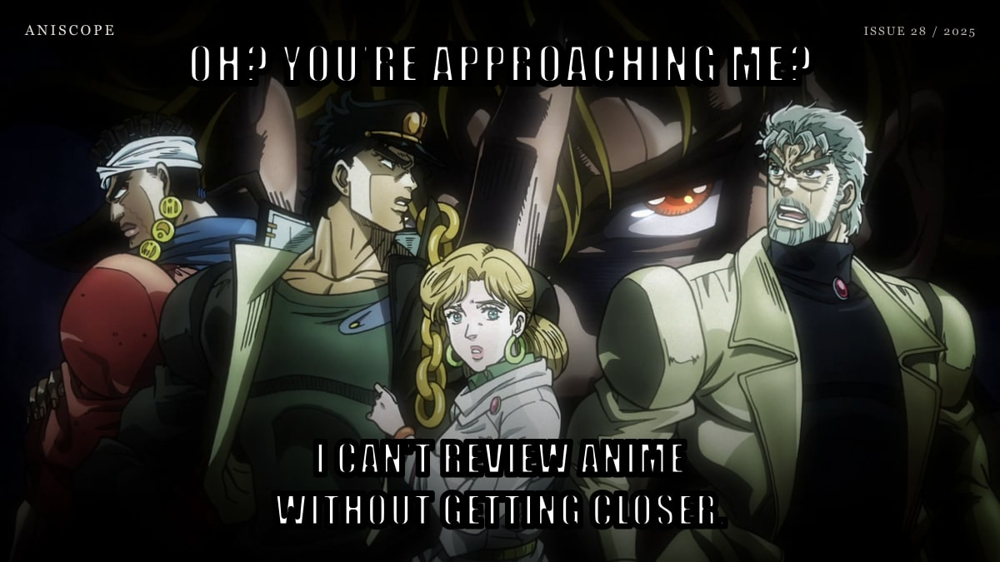

<p align="center">
  
</p>

<h1 align="center">AniScope</h1>

<p align="center">
  <strong>Aesthetic Criticism of Japanese Animation</strong><br>
  A five-page editorial magazine concept built with Node.js, Express, and hand-written HTML/CSS/JS.
</p>

<p align="center">
  <a href="#what-is-aniscope">About</a> ·
  <a href="#the-five-pages">Pages</a> ·
  <a href="#screenshots">Screenshots</a> ·
  <a href="#getting-started">Run locally</a> ·
  <a href="#bonus-jojo-meme">JoJo meme</a>
</p>

---

## What is AniScope?

**AniScope** is a fictional bimonthly journal about the aesthetics of Japanese animation. It treats anime as visual literature — looking at composition, colour, sound, adaptation, and the culture that grows around a work rather than only reviewing plot.

The site is also a front-end design study: a complete five-page editorial experience with a warm cream-and-crimson palette, oversized serif display type, bilingual Japanese/English details, dense magazine grids, long-form article layouts, and a small community profile.

> **Note:** AniScope is a portfolio/design project, not a real publication. Its authors, articles, issue numbers, and community members are invented.

---

## The Five Pages

| Route | Page | What is inside |
|---|---|---|
| `/` | **Home / Features** | Cover story on *Frieren*, three critical observations, the Spring 2025 aesthetic horizon, a long-form essay, and the newsletter block. |
| `/reviews` | **Reviews** | A full-length review of *Evangelion: 3.0+1.0*, with comparison figures, pull quotes, reading metadata, and a discussion section. |
| `/explore` | **Explore** | A curated catalogue of films and series, filter tabs, issue metadata, and pagination. |
| `/essays` | **Essays / The Critical Salon** | Three editorial essays, a reading-circle card, a reading ledger, and contributor dossiers. |
| `/community` | **Community** | Reiko Tachibana's profile, a currently-watching dashboard, canon shelves, a reading ledger, a calibration chart, and a scrapbook. |

---

## Screenshots

Click any thumbnail to open the full-page capture.

| Home | Reviews | Explore |
|:---:|:---:|:---:|
| [](docs/screenshots/home.jpg) | [](docs/screenshots/reviews.jpg) | [](docs/screenshots/explore.jpg) |

| Essays | Community | Overview |
|:---:|:---:|:---:|
| [](docs/screenshots/essays.jpg) | [](docs/screenshots/community.jpg) | [](docs/screenshots/overview.jpg) |

---

## Design Language

- **Palette:** warm paper cream, deep ink, and a restrained crimson accent.
- **Typography:** Bodoni Moda for display, Newsreader for long-form serif text, Jost for UI/sans details, and Noto Serif/Sans JP for Japanese lines.
- **Layout:** a 1284px desktop artboard translated into responsive CSS grids, with editorial rules, kickers, marginalia, and dense metadata.
- **Artwork:** real anime key visuals and posters, cropped to the exact dimensions of the original design slots so the layout does not shift.
- **Interaction:** vanilla JavaScript for active navigation, filter/tab states, form feedback, and image fades.

---

## Tech Stack

| Layer | Technology |
|---|---|
| Runtime | Node.js |
| Server | Express 4 |
| Templates | HTML with a tiny `{{HEADER}}` / `{{FOOTER}}` / `{{TITLE}}` include renderer |
| Styling | Hand-written CSS3 + CSS custom properties |
| Client JS | Vanilla JavaScript |
| Fonts | Google Fonts |
| Image processing | `sharp` during development (not required at runtime) |
| Database | None |

No React, Vue, Tailwind, build step, or database.

---

## Project Structure

```text
Aniscope/
├─ server.js                 # Express entry point + route renderer
├─ package.json
├─ views/
│  ├─ partials/
│  │  ├─ header.html
│  │  └─ footer.html
│  ├─ index.html             # Home / Features
│  ├─ reviews.html
│  ├─ explore.html
│  ├─ essays.html
│  └─ community.html
├─ public/
│  ├─ assets/                # anime artwork, portraits, favicon source
│  ├─ base.css               # shared design system
│  ├─ home.css
│  ├─ article.css
│  ├─ explore.css
│  ├─ essays.css
│  ├─ community.css
│  ├─ script.js
│  ├─ favicon.ico
│  ├─ favicon-16.png
│  ├─ favicon-32.png
│  └─ apple-touch-icon.png
├─ docs/
│  ├─ screenshots/           # full-page captures + thumbnails
│  └─ jojo-meme.jpg
└─ README.md
```

`views/*.html` are read on every request. The shared header/footer partials are cached at server startup, so restart the server after editing those partials.

---

## Getting Started

Requirements: **Node.js 18+**.

```bash
npm install
npm start
```

Open:

```text
http://localhost:5000
```

If port 5000 is already busy:

```powershell
$env:PORT=5001
npm start
```

> This is a Node/Express application. It is not a PHP app, so Laragon/Apache's static server will not execute `server.js`.

### Routes

| URL | Renders |
|---|---|
| `http://localhost:5000/` | `views/index.html` |
| `http://localhost:5000/reviews` | `views/reviews.html` |
| `http://localhost:5000/explore` | `views/explore.html` |
| `http://localhost:5000/essays` | `views/essays.html` |
| `http://localhost:5000/community` | `views/community.html` |

---

## Artwork & Credits

Anime key visuals and posters are sourced from the **AniList** and **Kitsu** CDNs for this non-commercial design study. They include work from:

*Frieren: Beyond Journey's End*, *The Boy and the Heron*, *Evangelion: 3.0+1.0 Thrice Upon a Time*, *The End of Evangelion*, *Delicious in Dungeon*, *Tari Tari*, *Astra Lost in Space*, *Mononoke*, *Tamako Market*, *Shirobako*, *Look Back*, *Mononoke: The Phantom in the Rain*, *Pluto*, *Chainsaw Man*, *The Colors Within*, *Ghost in the Shell*, *Cyberpunk: Edgerunners*, *Millennium Actress*, *The Tale of the Princess Kaguya*, and *Liz and the Blue Bird*.

All artwork, characters, and titles remain the property of their respective studios, licensors, and creators. No affiliation or endorsement is implied.

---

## Bonus: JoJo Meme



> "Oh? You're approaching me?" — you can't appreciate AniScope without getting closer.

---

<p align="center">
  Built by <a href="https://github.com/Gumiyaa">Gumiyaa</a> · 2025
</p>
